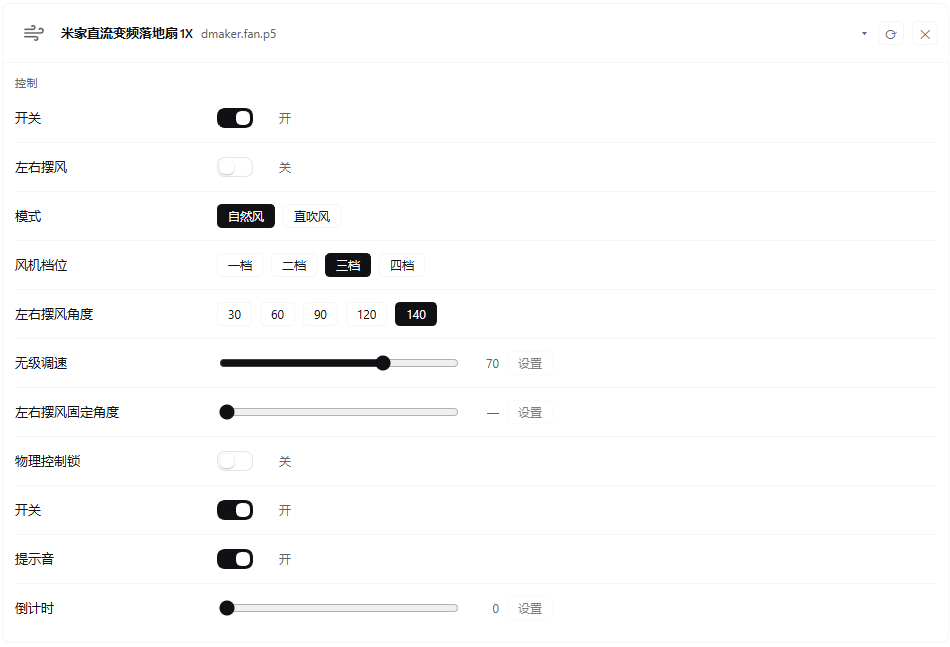

# dsh-mijia-sidebar

**English** | [简体中文](README.md)

A "Mijia Control" panel in the DSH (DeepSeek Harness) sidebar: device status, property reads and writes, device actions and manual scenes — one click each, with no model in the loop.

## Positioning and features

- **No model round-trip.** Panel operations go through the plugin's own RPC channel and are executed by the host half calling the local `mijiaAPI` CLI, so they cost no model context and no inference budget.
- **One channel for everything.** Every operation travels over this package's private `/mijia` RPC channel (`ctx.connection.register`) to the host half. Actions: `snapshot`, `props`, `state`, `get`, `set`, `action`, `run_scene`, `setHidden`.
- **All properties in one read.** Expanding a device fetches every readable property of that device with a single Mijia cloud call instead of one call per property (the CLI's `get` reads one property per process).
- **Chinese descriptions for properties and enum values.** Descriptions come from the miot-spec multiLanguage service first (cached locally for 7 days), fall back to a built-in map for entries it lacks, and stay in English when neither has them.
- **Hide devices, set aliases.** Devices you don't care about can be hidden from the panel (restore them from the bottom of the panel), and a device model can be given a display alias.
- **Expanded state persists.** The currently expanded device is kept in browser `localStorage`, so it survives panel switches and DSH restarts.
- **Card-based panel.** Devices sit in a card grid; an expanded card groups its controls under "Controls", "Status" and "Actions".
- **Built-in category icons.** The Mijia cloud sends no device icons, so the panel picks a built-in stroke glyph from the model string (fan, light, plug, air conditioner, router, sensor, cooker, …). If a payload does carry an icon URL, that icon is used directly.

## Panel sketch

A real screenshot, with a floor fan expanded: properties are grouped into Controls / Status / Actions, and both property names and enum values are translated to Chinese.



Layout (sketch):

```
 Sidebar                │ Mijia Control                  Updated 12:30   [Refresh]
 [#] Mijia Control      │ ──────────────────────────────────────────────────────────────────
 [ ] Other plugin       │ Scenes
                        │ [Home]   [Away]   [Movie]
                        │ Devices
                        │ ┌ Living room light - yeelink.light.stripe - online
                        │ ├ Floor fan         - zhimi.fan.za4        - online  (expanded)
                        │ │    Controls
                        │ │    Switch         ( # )   on
                        │ │    Fan level      [1] [2] [3] [4]
                        │ │    Swing angle    -----o-----   60   [Set]
                        │ │    Status
                        │ │    Temperature    26.5
                        │ │    Actions
                        │ │    [Turn on]   [Turn off]
                        │ └ Hidden devices (1)   [Restore Bedroom plug]
```

## Requirements

- **Python ≥ 3.10**, with either `python3` or `python` on `PATH` (on Windows the launcher's `py -3` is also accepted as a candidate).
- **mijiaAPI**, installed with the same interpreter you let the plugin use: `pip install mijiaAPI` (or `python -m pip install mijiaAPI`).
- **Mijia credentials.** Run `python -m mijiaAPI login` and scan the QR code; credentials land in `~/.config/mijia-api/auth.json`. That file belongs to mijiaAPI and is shared with the mijia MCP server — this plugin keeps no copy of its own.
- **DSH (DeepSeek Harness)**, with the host-side `connection` and `webServer` services available.

## Installation

All three routes end up as the same plugin bundle. **After the host half (`lib/*.js`, `lib/*.py`) changes, restart DSH for it to take effect**; browser-only changes just need a page reload.

### 1. From a local directory (bundle)

```bash
# run inside a DSH session; the path points at this repository
plugin_manager install_bundle /path/to/dsh-mijia-sidebar
```

The bundle entry point is `cordis.patch.yml`: it inserts one roster row that provides both the host half (package main → `lib/index.js`) and the browser half (`dsh.client` → `lib/client.js`).

### 2. From GitHub

```bash
git clone https://github.com/EchoChan314/dsh-mijia-sidebar.git
# then point the bundle install at the clone
plugin_manager install_bundle ./dsh-mijia-sidebar
```

### 3. From npm

```bash
npm install dsh-mijia-sidebar
# the install location depends on your package manager; point at the package directory
plugin_manager install_bundle ./node_modules/dsh-mijia-sidebar
```

## Configuration

### Config file

Path: `$DSH_HOME/mijia-sidebar.config.json`, by default `~/.dsh/mijia-sidebar.config.json` (on Windows `%USERPROFILE%\.dsh\mijia-sidebar.config.json`). A missing file, invalid JSON or a field with the wrong type all fall back to an empty config instead of raising. Hide/restore actions in the panel write back to the same file and preserve any other fields it contains.

```json
{
  "hiddenDids": ["105830834"],
  "aliases": {
    "zhimi.fan.za4": "Floor fan",
    "yeelink.light.stripe": "Living room light"
  }
}
```

| Field | Type | Description |
| --- | --- | --- |
| `hiddenDids` | `string[]` | Devices to hide, by `did`. The ✕ on a device card hides it, the buttons under "Hidden devices" restore it, and both read and write this array. |
| `aliases` | `object` | Model → display alias. The key is the device's `model` field; when it matches, the panel shows the alias and the original name appears on hover. |

### Environment variables

| Variable | Default | Description |
| --- | --- | --- |
| `MIJIA_PYTHON` | empty | Python interpreter used to run mijiaAPI (an absolute path is safest). It is tried first, and the chain continues if that interpreter does not work. |
| `DSH_HOME` | `~/.dsh` | DSH data directory. The config file and the log file live here. |

The interpreter is resolved from this candidate chain, taking the first one that works:

1. the `MIJIA_PYTHON` environment variable
2. `python3`
3. `python`
4. Windows only: `py -3`

When none of them is available the panel shows the `mijia/python-missing` guidance card.

### Logs

- Path: `$DSH_HOME/mijia-sidebar.log` (by default `~/.dsh/mijia-sidebar.log`).
- Written only for operations that change a device (`set`, `action`, …), one line each.
- The file is capped at 1 MiB; when it exceeds that it rotates to `mijia-sidebar.log.1` in the same directory. Only one rotated file is kept — older content is overwritten.
- A failing log write never blocks device control.

## Error codes and troubleshooting

When an RPC call fails the host half returns `{ ok: false, error: { code, message, details } }`: the panel shows that error card, whose text is `message` — already written as an actionable instruction. The table below is keyed by the error code. Anything not classified is reported as `mijia/error`.

| Error code | Symptom | What to do |
| --- | --- | --- |
| `mijia/python-missing` | The panel says no Python interpreter was found; the device list never loads. | Install Python ≥ 3.10 and make sure `python` / `python3` is on `PATH`, or set `MIJIA_PYTHON` to an absolute interpreter path and restart DSH. |
| `mijia/dependency-missing` | The interpreter starts, but importing `mijiaAPI` fails. | Install the dependency with that **same** interpreter: `<interpreter> -m pip install mijiaAPI`. This is the usual trap on machines with several Pythons. |
| `mijia/auth-missing` | The panel reports missing credentials. | Run `python -m mijiaAPI login` and scan the QR code; make sure the result lands in `~/.config/mijia-api/auth.json`. |
| `mijia/auth-expired` | Things worked before, now the panel reports an expired login. | Log in again with `python -m mijiaAPI login`; Mijia sessions expire on their own. |
| `mijia/timeout` | An operation hangs and finally reports a timeout (30 s per call). | Check connectivity to the Mijia cloud and retry; reads get slow when devices are offline. |
| `mijia/error` | Anything else; `message` carries the tail of the CLI output. | Work from `message`. If it says `unknown action`, the browser half and host half are different versions — restart DSH. |

## Privacy

- **Only six fields are sent to the browser.** The `list` mode of `lib/state.py` hands the browser half exactly six fields per device: `did`, `name`, `model`, `spec_type`, `online`, `icon`. Fields from the raw Mijia cloud response such as `token` and `localip` never enter the result and are never written to disk.
- **Logs hold no secrets.** `mijia-sidebar.log` records only did, property name and value (plus action names) — no credentials, no network details about devices.
- **Credentials stay with mijiaAPI.** `~/.config/mijia-api/auth.json` is read and written by mijiaAPI; this plugin never reads, copies or forwards the token inside it. The host half merely runs the CLI and lets it use its own credentials.
- **Device data stays on the machine.** Device lists and property values come from the local CLI process and reach the browser half on the same machine over DSH's own RPC channel.
- **Exactly one outbound request.** In `spec` mode, to obtain Chinese descriptions, the helper requests the miot-spec.org multiLanguage endpoint with the `spec_type` only — no device data, no credentials. The result is cached in `~/.config/mijia-api/<spec_type>.lang.json` for 7 days. If you don't need those descriptions you can simply not expand devices, or work offline (a failed request falls back to the built-in map).

## How it works

- **Browser half** (`lib/client.js`) registers the sidebar entry under `sidebar.panellist` and the panel itself under `main` with the same id, so clicking the icon opens the panel. It styles with DSH `--dsw-alias-*` theme tokens only and has no build step.
- **Host half** (`lib/index.js`) receives actions on the `/mijia` channel and shells out to `python -m mijiaAPI`; the device list, specs and batched state reads go through the helper script `lib/state.py`.
- **Panel controls:** booleans get a switch, enums get option buttons, numbers get a slider plus a "Set" button, text properties get an input (Enter or "Set"), read-only properties just display their value, and enum values are shown as "description (raw value)". Device action buttons, manual scene buttons and hide/restore behave the same way.
- **Reconciling writes:** the Mijia cloud often returns the stale value immediately after a write, so the panel applies the requested value optimistically and then re-reads to confirm, retrying a few times.

## Development and testing

Layout:

```
lib/index.js      host half: RPC actions, config, logs and rotation, interpreter resolution
lib/client.js     browser half: sidebar entry and panel UI (hand-written classic script, no build)
lib/state.py      helper script: list / state / spec modes
lib/parse.js      pure functions: parsing of CLI text output (unit-testable)
locale/zh.json    panel title and description (Chinese)
locale/en.json    panel title and description (English)
cordis.patch.yml  bundle entry point
```

Commands:

```bash
npm test        # node --test (no path argument; the runner finds **/*.test.js)
npm run check   # node --check on the JS files + python -m py_compile lib/state.py
```

CI (GitHub Actions, `.github/workflows/ci.yml`) runs on push and pull request: Node syntax checks, `node --test`, the Python compile check, and JSON validation of `locale/*.json` and `package.json`.

## License

MIT — see [LICENSE](LICENSE) for the full text.

## Credits

- [mijiaAPI](https://github.com/Do1e/mijia-api): the command-line tool and Python library for the Mijia cloud; it performs all device listing, property reads and writes, actions and scene runs in this plugin.
- The [miot-spec](https://miot-spec.org) multiLanguage service: the source of the Chinese descriptions for property names, enum values and action names.
