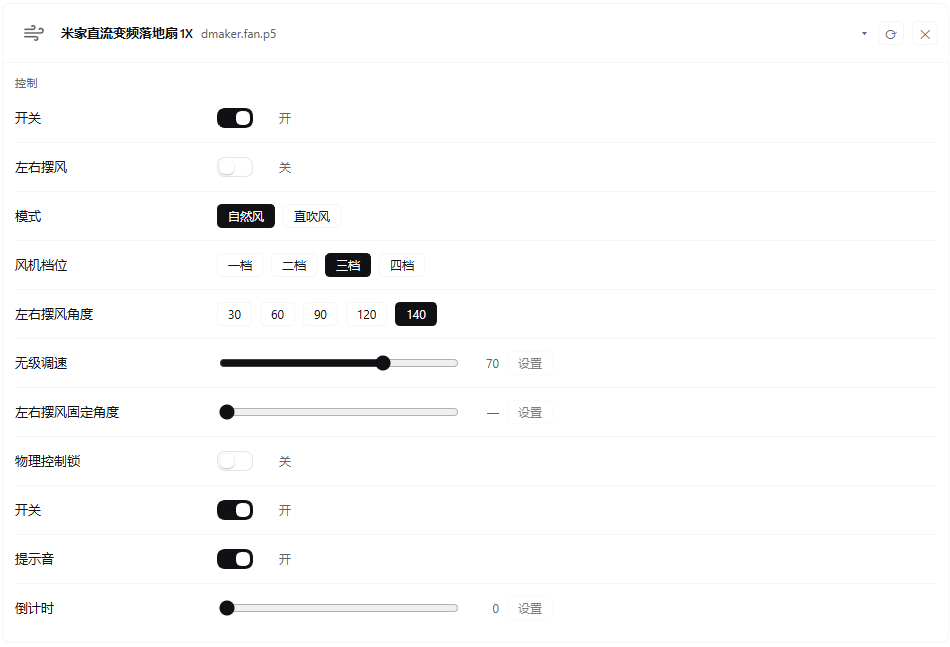

# dsh-mijia-sidebar

[English](README.en.md) | **简体中文**

DSH（DeepSeek Harness）侧边栏里的「米家控制」面板：设备状态、属性读写、设备动作与手动场景，点一下就执行，全程不经过大模型。

## 定位与特性

- **不经过大模型**：面板操作走插件自己的 RPC 通道，由 Host 半区直接调用本机 `mijiaAPI` CLI，不占用模型的上下文和额度。
- **一个通道管全部**：所有操作经本包私有的 `/mijia` RPC 通道（`ctx.connection.register`）到达 Host 半区，动作有 `snapshot` / `props` / `state` / `get` / `set` / `action` / `run_scene` / `setHidden`。
- **一次读回全部属性**：展开设备时，用一次米家云调用取回该设备所有可读属性，而不是每个属性单读一次（CLI 的 `get` 一次只能读一个属性）。
- **属性与枚举的中文说明**：属性名、枚举取值的说明优先取 miot-spec 的 multiLanguage 服务（本地缓存 7 天），它没有的条目回退到内置词表，仍未收录的保持英文原文。
- **隐藏设备与别名**：面板内可隐藏不关心的设备（底部随时恢复），也可按型号给设备配显示别名。
- **展开状态持久化**：当前展开的设备记在浏览器 `localStorage`，切换面板或重启 DSH 后仍保持展开。
- **卡片式面板**：设备以卡片网格排列，展开后在「控制 / 状态 / 动作」三组里给出对应控件。
- **内置分类图标**：米家云端不下发设备图标，面板按型号关键字匹配内置线性图标（风扇、灯、插座、空调、路由器、传感器、厨电等）；若某个字段确实带回了图标地址，则直接用该图标。

## 面板示意

展开落地扇后的面板（真实截图）：属性按「控制 / 状态 / 动作」分组，属性与枚举取值已翻译为中文。



面板布局（示意图）：

```
 侧边栏                 │ 米家控制                       更新于 12:30   [刷新]
 [#] 米家控制           │ ──────────────────────────────────────────────────────────────────
 [ ] 其他插件           │ 场景
                        │ [回家]   [离家]   [观影]
                        │ 设备
                        │ ┌ 客厅吊灯 - yeelink.light.stripe - 在线
                        │ ├ 落地扇   - zhimi.fan.za4        - 在线  (已展开)
                        │ │   控制
                        │ │   开关        ( # )   开
                        │ │   风速档位    [1 档] [2 档] [3 档] [4 档]
                        │ │   摆头角度    -----o-----   60   [设置]
                        │ │   状态
                        │ │   温度        26.5
                        │ │   动作
                        │ │   [开机]   [关机]
                        │ └ 已隐藏设备 (1)   [恢复 卧室插座]
```

## 前置条件

- **Python ≥ 3.10**，并且 `python3` 或 `python` 在 PATH 中（Windows 上安装器自带的 `py -3` 也可作为候选）。
- **mijiaAPI**：用同一个解释器执行 `pip install mijiaAPI`（或 `python -m pip install mijiaAPI`）。
- **米家登录凭证**：执行 `python -m mijiaAPI login` 扫码登录，凭证写到 `~/.config/mijia-api/auth.json`。这份凭证由 mijiaAPI 自己维护，与 mijia MCP server 共用，本插件不另存一份。
- **DSH（DeepSeek Harness）**：本插件需要 Host 侧的 `connection` 与 `webServer` 服务。

## 安装

三种方式装进 DSH 后效果一样，装完重启或刷新即可用。**Host 半区（`lib/*.js`、`lib/*.py`）有改动时，必须在 DSH 里重启插件进程后生效**；只改浏览器半区时刷新页面即可。

### 1. 从本地目录安装（bundle 方式）

```bash
# 在 DSH 会话里执行，路径指向本仓库目录
plugin_manager install_bundle /path/to/dsh-mijia-sidebar
```

bundle 的入口是 `cordis.patch.yml`，它在插件清单里插入一行，同时提供 Host 半区（包入口 `lib/index.js`）和浏览器半区（`dsh.client` → `lib/client.js`）。

### 2. 从 GitHub 安装

```bash
git clone https://github.com/EchoChan314/dsh-mijia-sidebar.git
# 然后指向克隆下来的目录
plugin_manager install_bundle ./dsh-mijia-sidebar
```

### 3. 从 npm 安装

```bash
npm install dsh-mijia-sidebar
# 安装位置按包管理器而定，指向落盘后的包目录
plugin_manager install_bundle ./node_modules/dsh-mijia-sidebar
```

## 配置参考

### 配置文件

路径：`$DSH_HOME/mijia-sidebar.config.json`，默认 `~/.dsh/mijia-sidebar.config.json`（Windows 为 `%USERPROFILE%\.dsh\mijia-sidebar.config.json`）。文件不存在、内容损坏或字段类型不对时，都按空配置处理，不会报错。面板里的隐藏/恢复操作会写回同一份文件，写入时保留文件中的其他字段。

```json
{
  "hiddenDids": ["105830834"],
  "aliases": {
    "zhimi.fan.za4": "落地扇",
    "yeelink.light.stripe": "客厅吊灯"
  }
}
```

| 字段 | 类型 | 说明 |
| --- | --- | --- |
| `hiddenDids` | `string[]` | 隐藏设备的 `did` 列表。面板卡片右上角的 ✕ 隐藏，底部「已隐藏设备」里的按钮恢复，读写的就是这个数组。 |
| `aliases` | `object` | 型号 → 显示别名。键为设备的 `model` 字段，命中后面板显示别名，把鼠标停在名字上可看到原设备名。 |

### 环境变量

| 变量 | 默认 | 说明 |
| --- | --- | --- |
| `MIJIA_PYTHON` | 空 | 指定运行 mijiaAPI 的 Python 解释器（绝对路径最稳妥）。会最先尝试它；该解释器不可用时继续往下试候选。 |
| `DSH_HOME` | `~/.dsh` | DSH 数据目录。配置文件、日志文件都在这个目录下。 |

解释器按候选顺序解析，取第一个可用的：

1. 环境变量 `MIJIA_PYTHON`
2. `python3`
3. `python`
4. 仅 Windows：`py -3`

一个候选都找不到时，面板显示 `mijia/python-missing` 的引导卡片。

### 日志

- 路径：`$DSH_HOME/mijia-sidebar.log`（默认 `~/.dsh/mijia-sidebar.log`）。
- 写入时机：只有会改动设备的操作（`set`、`action` 等）各写一行。
- 单文件上限 1 MiB；写满后轮转为同目录下的 `mijia-sidebar.log.1`，只保留一份历史文件，更早的内容被覆盖。
- 写日志失败不影响设备控制。

## 错误码排查

RPC 失败时 Host 半区返回 `{ ok: false, error: { code, message, details } }`：面板顶部显示的正是这张错误卡片，内容是 `message`（已经是可直接照做的处理指引），排查时以错误码为准。未归类的失败统一为 `mijia/error`。

| 错误码 | 现象 | 处理 |
| --- | --- | --- |
| `mijia/python-missing` | 提示找不到 Python 解释器，设备列表读不出来 | 安装 Python ≥ 3.10 并确认 `python` / `python3` 在 PATH 中；或设置 `MIJIA_PYTHON` 指向解释器绝对路径，再重启 DSH。 |
| `mijia/dependency-missing` | 解释器能启动，但报 `mijiaAPI` 导入失败 | 用**同一个**解释器装依赖：`<解释器> -m pip install mijiaAPI`。系统里装了多个 Python 时最常踩这个坑。 |
| `mijia/auth-missing` | 提示缺少登录凭证 | 执行 `python -m mijiaAPI login` 扫码登录；确认凭证落在 `~/.config/mijia-api/auth.json`。 |
| `mijia/auth-expired` | 之前可用，现在提示登录已过期 | 重新执行 `python -m mijiaAPI login` 扫码；米家登录态会自然过期。 |
| `mijia/timeout` | 操作迟迟没有结果，最后报超时（单次调用上限 30 秒） | 检查本机网络与米家云端连通性，稍后重试；设备离线时读取也会变慢。 |
| `mijia/error` | 其他失败，`message` 里带 CLI 输出的尾部内容 | 按 `message` 排查；若提示 `unknown action`，说明浏览器半区与 Host 半区版本不一致，重启 DSH 即可。 |

## 隐私说明

- **只下发六个字段**：助手脚本 `lib/state.py` 的 list 模式只把 `did`、`name`、`model`、`spec_type`、`online`、`icon` 六个字段交给浏览器半区。米家云端原始响应里的 `token`、`localip` 等字段不会进入下发结果，也不落盘。
- **日志不含敏感信息**：`mijia-sidebar.log` 只记录 did、属性名与值（以及动作名），没有凭证、没有设备网络信息。
- **凭证由 mijiaAPI 自己管理**：`~/.config/mijia-api/auth.json` 由 mijiaAPI 读写，本插件不读取、不复制、不转发其中的 token；Host 半区只是把 CLI 跑起来，让它自己用那份凭证。
- **设备数据不出本机**：设备列表、属性值都来自本机 CLI 进程的输出，经 DSH 自己的 RPC 通道送到同一台机器上的浏览器半区。
- **仅一处对外请求**：`spec` 模式需要属性与枚举的中文说明时，会带 `spec_type` 请求 `miot-spec.org` 的 multiLanguage 接口，请求里不含设备信息和凭证；结果缓存在 `~/.config/mijia-api/<spec_type>.lang.json`（有效期 7 天）。不需要中文说明时可以不展开设备，或断网使用（失败即回退内置词表）。

## 工作方式

- **浏览器半区**（`lib/client.js`）在 `sidebar.panellist` 注册侧边栏入口，在 `main` 注册同名主体面板，点入口图标打开面板。样式只用 DSH 的 `--dsw-alias-*` 主题变量，没有构建步骤。
- **Host 半区**（`lib/index.js`）在 `/mijia` 通道上接收动作，逐个调用 `python -m mijiaAPI`；设备列表、规格与批量状态读取走助手脚本 `lib/state.py`。
- **面板能力**：bool 属性用开关；枚举属性用选项按钮；数值属性用滑块加「设置」按钮；文本属性用输入框（回车或「设置」提交）；只读属性直接显示值；枚举值显示为「说明（原值）」。设备动作按钮、手动场景按钮、隐藏与恢复同上。
- **写入后的核对**：米家云端在写入后立即回读常常返回旧值，所以面板先按请求值乐观更新，再回读比对，最多重试几次。

## 开发与测试

目录结构：

```
lib/index.js      Host 半区：RPC 动作、配置读写、日志与轮转、解释器解析
lib/client.js     浏览器半区：侧边栏入口与面板 UI（手写 classic script，无构建）
lib/state.py      助手脚本：list / state / spec 三种模式
lib/parse.js      纯函数：CLI 文本输出解析（可单测）
locale/zh.json    面板标题与描述（中文）
locale/en.json    面板标题与描述（英文）
cordis.patch.yml  bundle 入口
```

常用命令：

```bash
npm test        # node --test（不带路径参数，自行发现 **/*.test.js）
npm run check   # node --check 三个 JS 文件 + python -m py_compile lib/state.py
```

CI（GitHub Actions，`.github/workflows/ci.yml`）在 push 与 pull request 上执行：Node 语法检查、`node --test`、Python 编译检查，以及 `locale/*.json` 与 `package.json` 的 JSON 校验。

## License

MIT，全文见 [LICENSE](LICENSE)。

## 致谢

- [mijiaAPI](https://github.com/Do1e/mijia-api)：米家云端的命令行工具与 Python 库，本插件的设备列举、属性读写、动作与场景执行都由它完成。
- [miot-spec](https://miot-spec.org) 的 multiLanguage 服务：属性名、枚举取值与动作名的中文说明来源。
